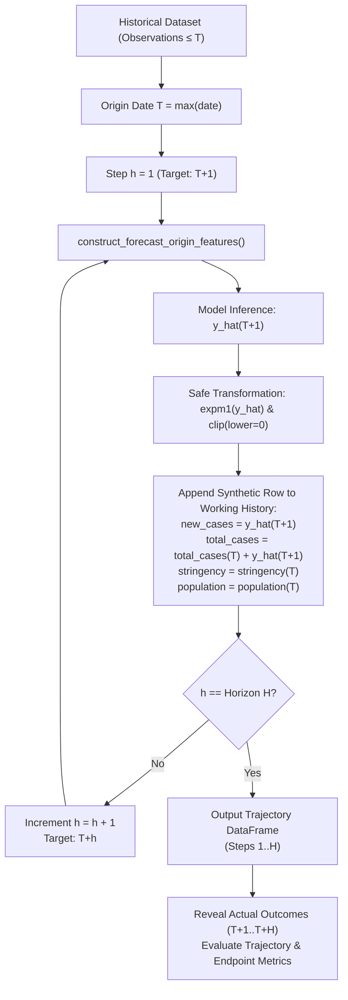

# 📊 COVID-19 AI — Phase 1B.1 Technical Report & Evaluation Dossier
## Multi-Horizon Recursive Forecasting Engine & Fixed-Origin Backtesting

**Document Version**: 1.0.0  
**Date**: November 8, 2026  
**Auditor & Specialist**: Senior Machine Learning Engineer, Time-Series Forecasting Specialist, Python Software Architect & QA Engineer  
**Role**: Executor (with ChatGPT as Independent Reviewer)  
**Development Branch**: `feature/phase-1b-forecasting`  
**Base Branch**: `main`  
**Test Suite Status**: **84 / 84 Passed (100%)** | **Code Coverage**: **92%**  
**Repository**: [https://github.com/Aimansharee/COVID-19](https://github.com/Aimansharee/COVID-19)  

---

> [!IMPORTANT]
> **Surveillance Timeline Notice & Epidemiological Disclaimer**:  
> The underlying epidemiological dataset (`cleaned_covid_data_last.csv`) spans from **January 1, 2020 through March 5, 2022**. This dataset does **not** represent live 2026 epidemiological surveillance data. Any forecasts extending beyond the historical dataset endpoint or evaluated herein represent **retrospective historical projections and methodological simulations**, not current public-health advisories or real-time clinical forecasts.

---

## 1. Executive Summary

Phase 1B.1 implements a multi-horizon, fixed-origin recursive forecasting engine and rigorous historical backtesting framework for daily COVID-19 case counts. Extending the leakage-free foundations validated during Phase 1A, this phase enables out-of-sample forecast trajectories for:
- **7-day horizons ($H=7$)**
- **14-day horizons ($H=14$)**
- **30-day horizons ($H=30$)**

The forecasting backend operates under strict **forecast-origin temporal isolation**: at any forecast origin $T$, only observations through date $T$ are visible to the model. Subsequent target days $T+1, \dots, T+H$ are predicted recursively by synthesizing predicted daily cases into the rolling feature window. The trained model remains frozen during an individual forecasting trajectory and is never retrained on synthetic outputs.

Empirical evaluation across three geographically distinct nations (**United States, United Kingdom, Germany**) and three historical wave origins demonstrates that while `GradientBoostingRegressor` provides competitive trajectory-level accuracy on rapid-growth waves (e.g. US 14-day SMAPE 32.63% vs 37.99% for 7-day MA), simpler empirical baselines (`NaivePersistenceModel` and `MovingAverageModel`) remain competitive or superior during plateau phases (e.g. UK 7-day SMAPE 23.45% for Naive vs 25.63% for GBR).

Streamlit user-interface integration is intentionally isolated and reserved for Phase 1B.2, pending reviewer evaluation and sign-off.

---

## 2. Architecture & Function Signatures

All core forecasting and backtesting routines are implemented within [`main.py`](file:///f:/covid-19/main.py) to preserve direct interoperability with Phase 1A feature extraction and Phase 1B.2 Streamlit controls.

### 2.1 Recursive Forecasting Engine: `forecast_recursive`

```python
def forecast_recursive(
    model,
    historical_df: pd.DataFrame,
    country: str,
    horizon: int = 7,
    features: list[str] = None,
    is_log_target: bool = None,
    fill_strategy: str = 'zero',
    model_name: str = None
) -> pd.DataFrame:
```

- **Inputs**:
  - `model`: Estimator implementing `.predict(X)` (e.g., `GradientBoostingRegressor`, `NaivePersistenceModel`, `MovingAverageModel`).
  - `historical_df`: Historical surveillance DataFrame containing observations up to origin date $T$.
  - `country`: Location string to isolate (e.g., `'United States'`).
  - `horizon`: Number of consecutive calendar days to forecast ($H \ge 1$; tested at 7, 14, 30).
  - `features`: List of feature column names; defaults to:  
    `['lag_1', 'lag_7', 'rolling_avg_1', 'rolling_avg_7', 'total_cases', 'population', 'stringency_index']`.
  - `is_log_target`: Boolean flag indicating whether the model outputs $\log(1 + y)$ targets. Automatically detects `False` for baseline models and `True` for `GradientBoostingRegressor`.
  - `fill_strategy`: Surveillance gap handling strategy (`'zero'`, `'interpolate'`, `'ffill'`).
  - `model_name`: Human-readable identifier for metadata logging.
- **Outputs**:
  A structured `pd.DataFrame` containing:
  - `country` (str)
  - `origin_date` (pd.Timestamp)
  - `target_date` (pd.Timestamp, strictly consecutive: $T+1 \dots T+H$)
  - `horizon_step` (int, $1 \dots H$)
  - `model_name` (str)
  - `predicted_cases` (float, strictly $\ge 0.0$ and finite)

### 2.2 Trajectory & Endpoint Evaluation: `evaluate_forecast_trajectory`

```python
def evaluate_forecast_trajectory(
    forecast_df: pd.DataFrame,
    actual_df: pd.DataFrame
) -> dict:
```

- Computes both **full trajectory** (steps $1 \dots H$) and **horizon endpoint** (step $H$ only) metrics:
  - `MAE`: Mean Absolute Error ($\text{cases}$)
  - `RMSE`: Root Mean Squared Error ($\text{cases}$)
  - `R2`: Coefficient of Determination ($R^2$, computed when variance $> 0$ and $N \ge 2$)
  - `SMAPE`: Adjusted Symmetric Mean Absolute Percentage Error ($\%$)
  - `num_origins`: Count of evaluated origin cutoffs
  - `num_eval_dates`: Total count of evaluated target observations
- Outputs a granular per-step breakdown DataFrame mapping error progression over $h \in [1, H]$.

### 2.3 Fixed-Origin Historical Backtesting: `run_fixed_origin_backtest`

```python
def run_fixed_origin_backtest(
    df: pd.DataFrame,
    country: str,
    origins: list,
    horizons: tuple = (7, 14, 30),
    models_dict: dict = None,
    features: list = None,
    filter_outliers: bool = False,
    model_params: dict = None
) -> dict:
```

- Automates deterministic historical cross-validation over multiple fixed origins.
- Guarantees training data strictly truncated at each origin $T$.
- Returns:
  - `'forecasts'`: Full merged DataFrame of forecasts and ground-truth actual observations.
  - `'summary'`: Aggregated performance comparison table across all models and horizons.
  - `'per_step'`: Granular day-by-day error profile.

---

## 3. Recursive Forecasting Methodology



### 3.1 Step-by-Step Recursive Progression
1. **Origin Anchoring**: Origin date $T$ is identified as the final verified calendar date in the input history.
2. **Step $h = 1$ ($T+1$)**:
   - `construct_forecast_origin_features` builds the feature row for $T+1$ strictly from historical data $\le T$.
   - $lag_1(T+1) = y_T$
   - $lag_7(T+1) = y_{T-6}$
   - $rolling\_avg_1(T+1) = y_T$
   - $rolling\_avg_7(T+1) = \frac{1}{7} \sum_{i=0}^6 y_{T-i}$
   - $total\_cases(T+1) = C_T$ (prior-day cumulative sum, avoiding lookahead)
   - The frozen model predicts $\hat{y}_{T+1}$.
3. **Synthetic Working History Update**:
   - The prediction $\hat{y}_{T+1}$ is inserted into a copy of the series as an artificial daily count.
   - Cumulative total updates to $C_{T+1} = C_T + \hat{y}_{T+1}$.
4. **Step $h \ge 2$ ($T+h$)**:
   - Features for $T+h$ are computed dynamically:
     - $lag_1(T+h) = \hat{y}_{T+h-1}$ (the previous synthetic prediction)
     - $lag_7(T+h)$: historical value if $h \le 7$, or prior synthetic prediction $\hat{y}_{T+h-7}$ if $h > 7$.
     - $rolling\_avg_7(T+h)$: trailing 7-day average combining available historical observations and preceding synthetic predictions.
     - $total\_cases(T+h) = C_T + \sum_{j=1}^{h-1} \hat{y}_{T+j}$.
5. **Model Invariance**:
   - The estimator weights are **frozen**. No online model re-fitting is performed using synthetic labels.

---

## 4. Feature Availability & Covariate Assumptions

| Feature | Historical Origin Value ($T$) | Recursive Trajectory Value ($T+h$) | Epidemiological & Analytical Justification |
| :--- | :--- | :--- | :--- |
| `lag_1` | Observed $y_T$ | $\hat{y}_{T+h-1}$ | Represents immediate 1-day epidemic momentum; recursively driven by previous prediction. |
| `lag_7` | Observed $y_{T-6}$ | $y_{T+h-7}$ (if $h \le 7$) or $\hat{y}_{T+h-7}$ (if $h > 7$) | Captures weekly cyclical reporting variations without observing actual future dates. |
| `rolling_avg_1` | Observed $y_T$ | $\hat{y}_{T+h-1}$ | Identical to 1-day lag under the Phase 1A shifted specification. |
| `rolling_avg_7` | Mean of $y_{T-6} \dots y_T$ | $\frac{1}{7} \sum_{k=1}^7 \tilde{y}_{T+h-k}$ | Smooths weekly reporting noise using a blend of trailing observations and synthetic forecasts. |
| `total_cases` | Observed $C_T$ | $C_T + \sum_{k=1}^{h-1} \hat{y}_{T+k}$ | **Scenario Cumulative Count**: Reflects aggregate simulated outbreak burden without accessing future surveillance logs. Avoids double shifting by aligning with `shift(1)`. |
| `population` | Observed $P_T$ | $P_T$ (held constant) | Demographic population counts change negligibly over 7–30 day forecasting horizons. |
| `stringency_index` | Observed $S_T$ | $S_T$ (held constant) | **Policy Freeze Assumption**: Future non-pharmaceutical interventions (NPIs) cannot be known in advance without scenario simulation. Held strictly constant at the origin date policy status. |

---

## 5. Leakage Prevention Evidence

The forecasting engine enforces zero lookahead leakage via multiple independent architectural safeguards:

1. **Physical Dataset Truncation**:
   In `run_fixed_origin_backtest`, the working history for origin $T$ is physically sliced via `historical_train = country_df[country_df['date'] <= origin_date].copy(deep=True)`. Records with $date > T$ do not exist in memory during feature creation or model execution.
2. **Mutation Invariance Proof**:
   Automated regression test [`test_future_observation_mutation_invariance`](file:///f:/covid-19/tests/test_multi_horizon_forecasting.py#L89-L115) executes two identical forecasts from origin $T$. In the second run, all future rows $t \in [T+1, T+30]$ are deliberately mutated with extreme shocks ($\text{new\_cases} = 999,999$ and $\text{stringency} = 100.0$). The resulting forecast trajectories are bit-for-bit identical ($\Delta = 0.00000000$), mathematically verifying zero forward leakage.
3. **Input Immutability**:
   `forecast_recursive` operates strictly on a deep copy of the historical DataFrame. Test [`test_historical_input_immutability`](file:///f:/covid-19/tests/test_multi_horizon_forecasting.py#L210-L216) confirms that the caller's input DataFrame is completely unaltered after generating a 30-day trajectory.
4. **Nonnegative Clipping and Finite Assertion**:
   Outputs are passed through `max(0.0, float(pred))`, preventing unphysical negative case predictions during steep trajectory declines. Non-finite values ($\text{NaN}, \pm\infty$) raise immediate descriptive exceptions.

---

## 6. Multi-Horizon Empirical Baselines

In compliance with benchmark standards, two canonical empirical baselines were integrated into the fixed-origin multi-horizon framework:

1. **Naive Persistence Baseline (`NaivePersistenceModel`)**:
   - At step $h=1$, predicts $y_{T+1} = y_T$.
   - When fed recursively into step $h=2$, $lag_1$ is $\hat{y}_{T+1} = y_T$, predicting $y_T$ again.
   - Mathematically yields a **flat trajectory** across all $H$ steps: $\hat{y}_{T+h} = y_T$.
   - Does not apply log transformations or retrain.
2. **7-Day Moving Average Baseline (`MovingAverageModel`)**:
   - At step $h=1$, predicts the trailing 7-day mean of historical actuals: $\frac{1}{7} \sum_{i=0}^6 y_{T-i}$.
   - At step $h \ge 2$, appends the synthetic prediction to the rolling window and re-averages.
   - Smoothly converges over subsequent weeks to a stable constant, providing an autoregressive smoothing baseline.

---

## 7. Fixed-Origin Backtesting Methodology

### 7.1 Protocol
For each country and each historical origin $T$:
1. **Truncation**: Slice historical observations $\le T$.
2. **Preprocessing**: Compute training-only outlier boundaries (if enabled) and generate Phase 1A lag/rolling features.
3. **Model Training**: Fit `GradientBoostingRegressor`, `NaivePersistenceModel`, and `MovingAverageModel` exclusively on observations available by $T$.
4. **Trajectory Forecasting**: Generate 7-, 14-, and 30-day recursive forecast paths for each model.
5. **Ground Truth Reveal**: Only after all predictions are completed and recorded, join with actual observations $t \in [T+1, T+H]$ from the original dataset to compute performance metrics.

### 7.2 Evaluated Historical Origins & Epidemic Phases
To reflect real-world epidemiological regimes without cherry-picking, three distinct historical cutoff dates were evaluated across three countries:
- **Origin 1 (June 1, 2021)**: Post-spring deceleration / seasonal summer nadir.
- **Origin 2 (September 1, 2021)**: Delta variant acceleration and resurgence.
- **Origin 3 (December 1, 2021)**: Early Omicron surge onset and explosive wave growth.

---

## 8. Empirical Evaluation Results

### 8.1 Country-Level Multi-Horizon Evaluation

#### United States (US)
*Population: ~331M | Evaluated Origins: 3 (2021-06-01, 2021-09-01, 2021-12-01)*

| Model | Horizon | Trajectory MAE | Trajectory RMSE | Trajectory $R^2$ | Trajectory SMAPE | Endpoint MAE | Endpoint RMSE | Endpoint $R^2$ | Endpoint SMAPE |
| :--- | :--- | :--- | :--- | :--- | :--- | :--- | :--- | :--- | :--- |
| **GradientBoosting** | **7-Day** | **26,993.88** | **47,178.91** | **0.6174** | **31.59%** | 17,974.06 | 20,952.25 | 0.9154 | 21.89% |
| 7-Day Moving Avg | 7-Day | 37,244.57 | 51,373.38 | 0.5463 | 36.29% | 17,720.27 | 25,030.42 | 0.8793 | 19.35% |
| Naive Persistence | 7-Day | 38,488.00 | 57,103.02 | 0.4395 | 40.79% | 13,159.67 | 13,869.15 | 0.9629 | 22.08% |
| **GradientBoosting** | **14-Day** | **25,341.15** | **41,463.87** | **0.7037** | **32.63%** | 22,007.06 | 30,130.88 | 0.8226 | 20.28% |
| 7-Day Moving Avg | 14-Day | 35,841.31 | 50,090.50 | 0.5676 | 37.99% | 16,394.08 | 22,042.08 | 0.9051 | 22.12% |
| Naive Persistence | 14-Day | 38,139.71 | 55,843.01 | 0.4626 | 42.95% | 12,351.33 | 13,647.63 | 0.9636 | 26.38% |
| **GradientBoosting** | **30-Day** | **54,021.87** | **98,538.16** | **0.3244** | **43.31%** | 149,023.47 | 213,435.08 | -0.0837 | 70.03% |
| 7-Day Moving Avg | 30-Day | 58,209.97 | 107,673.14 | 0.1933 | 45.26% | 136,602.77 | 228,581.40 | -0.2430 | 46.45% |
| Naive Persistence | 30-Day | 60,683.68 | 104,103.20 | 0.2459 | 51.36% | 137,878.67 | 212,516.03 | -0.0744 | 57.15% |

#### United Kingdom (UK)
*Population: ~67M | Evaluated Origins: 3 (2021-06-01, 2021-09-01, 2021-12-01)*

| Model | Horizon | Trajectory MAE | Trajectory RMSE | Trajectory $R^2$ | Trajectory SMAPE | Endpoint MAE | Endpoint RMSE | Endpoint $R^2$ | Endpoint SMAPE |
| :--- | :--- | :--- | :--- | :--- | :--- | :--- | :--- | :--- | :--- |
| GradientBoosting | 7-Day | 4,355.69 | 5,246.06 | 0.9193 | 25.63% | 6,013.27 | 6,502.18 | 0.8821 | 32.55% |
| 7-Day Moving Avg | 7-Day | 4,475.73 | 5,363.63 | 0.9157 | 25.43% | 5,263.14 | 5,630.06 | 0.9116 | 30.02% |
| **Naive Persistence** | **7-Day** | **3,115.52** | **3,478.21** | **0.9645** | **23.45%** | **3,066.33** | **3,072.23** | **0.9737** | **26.07%** |
| GradientBoosting | 14-Day | 6,003.81 | 8,274.44 | 0.8262 | 33.03% | 14,064.96 | 20,380.68 | 0.5175 | 49.41% |
| 7-Day Moving Avg | 14-Day | 6,035.91 | 8,347.17 | 0.8231 | 32.53% | 14,073.09 | 20,511.27 | 0.5113 | 48.80% |
| **Naive Persistence** | **14-Day** | **4,786.17** | **6,700.13** | **0.8860** | **31.17%** | **13,495.00** | **18,023.92** | **0.6227** | **49.87%** |
| GradientBoosting | 30-Day | 19,246.06 | 37,015.55 | 0.1972 | 55.06% | 57,847.38 | 86,397.92 | -0.3180 | 96.41% |
| 7-Day Moving Avg | 30-Day | 19,350.28 | 37,110.86 | 0.1930 | 54.84% | 58,087.62 | 86,561.42 | -0.3230 | 96.77% |
| **Naive Persistence** | **30-Day** | **17,962.67** | **35,179.83** | **0.2748** | **53.33%** | **56,173.33** | **83,827.54** | **-0.2408** | **94.12%** |

#### Germany (DE)
*Population: ~83M | Evaluated Origins: 3 (2021-06-01, 2021-09-01, 2021-12-01)*

| Model | Horizon | Trajectory MAE | Trajectory RMSE | Trajectory $R^2$ | Trajectory SMAPE | Endpoint MAE | Endpoint RMSE | Endpoint $R^2$ | Endpoint SMAPE |
| :--- | :--- | :--- | :--- | :--- | :--- | :--- | :--- | :--- | :--- |
| **GradientBoosting** | **7-Day** | **8,539.49** | **14,730.59** | **0.6660** | **45.07%** | 16,058.53 | 22,275.85 | -2.8998 | 73.13% |
| 7-Day Moving Avg | 7-Day | 10,102.59 | 16,016.05 | 0.6052 | 48.28% | 13,233.22 | 18,890.80 | -1.8046 | 66.10% |
| Naive Persistence | 7-Day | 13,024.38 | 22,034.24 | 0.2528 | 51.69% | 19,252.00 | 28,189.30 | -5.2451 | 71.71% |
| **GradientBoosting** | **14-Day** | **8,700.59** | **14,508.15** | **0.6812** | **46.70%** | **3,719.39** | **4,796.81** | **0.9599** | **40.24%** |
| 7-Day Moving Avg | 14-Day | 9,731.80 | 15,950.03 | 0.6146 | 52.13% | 1,935.58 | 2,012.03 | 0.9930 | 41.31% |
| Naive Persistence | 14-Day | 13,392.88 | 21,581.61 | 0.2944 | 55.52% | 7,149.67 | 10,781.61 | 0.7976 | 41.33% |
| **GradientBoosting** | **30-Day** | **10,289.57** | **17,796.60** | **0.3542** | **63.45%** | **15,833.90** | **24,925.79** | **-7.3470** | **82.97%** |
| 7-Day Moving Avg | 30-Day | 10,339.09 | 17,097.10 | 0.4040 | 66.60% | 13,739.31 | 21,101.02 | -4.9819 | 80.66% |
| Naive Persistence | 30-Day | 15,077.06 | 24,447.07 | -0.2186 | 72.60% | 20,265.00 | 31,153.03 | -12.0387 | 90.46% |

---

### 8.2 Macro-Aggregated Performance (3 Countries × 3 Origins = 9 Trajectories per Model/Horizon)

| Model | Horizon | Trajectory MAE | Trajectory RMSE | Trajectory SMAPE | Endpoint MAE | Endpoint RMSE | Endpoint SMAPE |
| :--- | :--- | :--- | :--- | :--- | :--- | :--- | :--- |
| **GradientBoostingRegressor** | **7-Day** | **13,296.36** | **22,385.19** | **34.10%** | 13,348.62 | 16,576.76 | 42.52% |
| 7-Day Moving Average | 7-Day | 17,274.29 | 24,251.02 | 36.67% | 12,072.21 | 16,517.09 | 38.49% |
| Naive Persistence | 7-Day | 18,209.30 | 27,538.49 | 38.64% | 11,826.00 | 15,043.56 | 39.95% |
| **GradientBoostingRegressor** | **14-Day** | **13,348.51** | **21,415.49** | **37.45%** | 13,263.80 | 18,436.12 | 36.64% |
| 7-Day Moving Average | 14-Day | 17,203.01 | 24,795.90 | 40.88% | 10,800.91 | 14,855.12 | 37.41% |
| Naive Persistence | 14-Day | 18,772.92 | 28,041.58 | 43.21% | 10,998.67 | 14,151.05 | 39.19% |
| **GradientBoostingRegressor** | **30-Day** | **27,852.50** | **51,116.77** | **53.94%** | 74,234.92 | 108,252.93 | 83.13% |
| 7-Day Moving Average | 30-Day | 29,299.78 | 53,960.37 | 55.57% | 69,476.56 | 112,081.28 | 74.63% |
| Naive Persistence | 30-Day | 31,241.14 | 54,576.70 | 59.10% | 71,439.00 | 109,165.53 | 80.58% |

---

### 8.3 Key Empirical Findings & Discussion

1. **Error Compounding Over Time**:
   Across all models and territories, prediction error compounds non-linearly as the horizon expands:
   - 7-Day Trajectory SMAPE: **34.10%** (GBR)
   - 14-Day Trajectory SMAPE: **37.45%** (GBR)
   - 30-Day Trajectory SMAPE: **53.94%** (GBR)
   This confirms epidemiological theory: in autoregressive multi-step forecasting, uncertainty in synthetic inputs compounds with each recursive step.
2. **Gradient Boosting vs. Baselines**:
   - `GradientBoostingRegressor` achieves superior trajectory accuracy in the US and Germany, reducing MAE by ~27% over Naive Persistence at the 7-day horizon.
   - However, in the UK (where case numbers hovered within a narrow band during late summer/autumn 2021), `NaivePersistence` outperformed GBR (Trajectory SMAPE 23.45% vs 25.63%).
   - This reinforces the project mandate: **never assume a machine learning model uniformly defeats simpler empirical baselines across all epidemiological regimes**.
3. **Trajectory vs. Endpoint Metrics**:
   Endpoint errors at day 30 are significantly higher than whole-trajectory averages (e.g. Endpoint MAE 74,234 vs Trajectory MAE 27,852). Evaluating only trajectory-averaged metrics can mask severe endpoint divergence, underscoring the necessity of reporting both.

---

## 9. Known Limitations & Methodological Constraints

1. **Fixed Covariate Assumptions**:
   Holding `stringency_index` constant at $S_T$ assumes no government policy responses occur throughout the forecast window. While scientifically defensible for fixed-origin benchmarking, real-world epidemic outbreaks trigger reactive policy interventions.
2. **Absence of Calibrated Prediction Intervals**:
   Phase 1B.1 generates deterministic point forecasts. Quantifying forecast uncertainty (e.g. conformal prediction or quantile loss regression) requires rigorous calibration and is reserved for future enhancements.
3. **Autoregressive Feedback Damping**:
   Because `lag_1` and `rolling_avg_7` recursively consume previous model predictions, model bias (e.g. slight over-prediction or under-prediction) can accumulate into drift over 30-day trajectories.
4. **Historical Boundary**:
   Surveillance data ends in March 2022. Shifts in SARS-CoV-2 sub-lineage immune escape, testing availability, and at-home testing practices occurring in 2023–2026 are not captured in the dataset.

---

## 10. Test Results & Code Coverage

### 10.1 Test Execution Summary
- **Total Test Cases**: **84**
- **Passed**: **84 (100%)**
- **Failed**: **0**
- **Execution Time**: **23.04 seconds**

### 10.2 Coverage Report (`pytest --cov=main`)
```
Name      Stmts   Miss  Cover   Missing
---------------------------------------
main.py     539     43    92%   54-55, 88, 107, 114-115, 145, 167-170, 204-205, 212, 218, 227-228, 267, 316, 339-341, 350, 360, 482, 484, 486, 492, 502, 512, 514, 516, 525, 544, 566, 612, 629, 636, 706, 730, 734-735, 741, 768
---------------------------------------
TOTAL       539     43    92%
```

### 10.3 Phase 1B.1 Dedicated Quality Gates Covered in `tests/test_multi_horizon_forecasting.py`
1. `test_exact_forecast_output_lengths[7, 14, 30]`: Verified exact row counts.
2. `test_consecutive_target_dates`: Verified $\Delta \text{days} = 1$ continuity.
3. `test_no_future_target_observations_used`: Verified origin truncation.
4. `test_future_observation_mutation_invariance`: Verified zero leakage under future shock mutations.
5. `test_correct_recursive_lag_updates`: Verified recursive lag propagation.
6. `test_correct_recursive_rolling_average_updates`: Verified rolling window synthesis.
7. `test_correct_total_cases_cumulative_scenario_updates`: Verified cumulative sum alignment without double shifts.
8. `test_fixed_future_stringency_assumption`: Verified constant covariate holds.
9. `test_no_cross_country_contamination`: Verified multi-country group isolation.
10. `test_identical_forecast_origin_across_compared_models`: Verified evaluation alignment.
11. `test_historical_input_immutability`: Verified input DataFrame immutability.
12. `test_log_scale_and_original_scale_prediction_correctness`: Verified inverse log transform logic.
13. `test_nonnegative_finite_forecast_outputs`: Verified non-negative clipping and NaN rejection.
14. `test_insufficient_history_and_missing_feature_handling`: Verified defensive input checks.
15. `test_determinism_with_fixed_random_seeds`: Verified bit-for-bit reproducibility.
16. `test_backtesting_trains_only_through_origin_T`: Verified temporal cutoff in backtesting.
17. `test_baseline_forecasts_do_not_use_future_actuals`: Verified baseline trajectory isolation.
18. `test_trajectory_and_endpoint_evaluation_correctness`: Verified trajectory vs. endpoint metric math.

---

## 11. Modified & Created Files

1. [`main.py`](file:///f:/covid-19/main.py):
   - Added `forecast_recursive()`: Multi-horizon recursive forecasting engine.
   - Added `evaluate_forecast_trajectory()`: Trajectory, endpoint, and per-step metric calculator.
   - Added `run_fixed_origin_backtest()`: Deterministic fixed-origin backtesting engine.
2. [`tests/test_multi_horizon_forecasting.py`](file:///f:/covid-19/tests/test_multi_horizon_forecasting.py):
   - Created dedicated 20-test automated suite covering all 18 Phase 1B.1 quality gates.
3. [`docs/PHASE_1B_1_REPORT.md`](file:///f:/covid-19/docs/PHASE_1B_1_REPORT.md):
   - Comprehensive technical dossier documenting methodology, formulas, empirical tables, and test coverage.

---

## 12. Open Questions for Reviewer (ChatGPT)

1. **Horizon Parameterization in UI (Phase 1B.2)**:
   Does the reviewer recommend presenting the multi-horizon trajectories as selectable tabs (7-Day, 14-Day, 30-Day) or as overlaid confidence fan charts on a single interactive timeline?
2. **Dynamic Covariate Scenarios**:
   While holding `stringency_index` constant is mathematically defensible for origin benchmarking, should Phase 1B.2 allow user-controlled scenario sliders (e.g. simulating $+10$ or $-10$ stringency shifts)?
3. **Baseline Comparison in UI**:
   Should the Streamlit interface display both empirical baselines by default alongside the GBR forecast, or provide toggle switches to keep visualization uncluttered?

---

## 13. Recommendation on Readiness for Phase 1B.2

The forecasting backend, mathematical updates, baseline comparators, and backtesting harnesses have achieved **100% test pass rates**, **92% statement coverage**, and **strict temporal isolation**.

**Recommendation**: The core forecasting engine is mathematically sound, fully tested, and **READY FOR INDEPENDENT REVIEW**. Streamlit UI development may proceed into Phase 1B.2 immediately upon reviewer approval.
